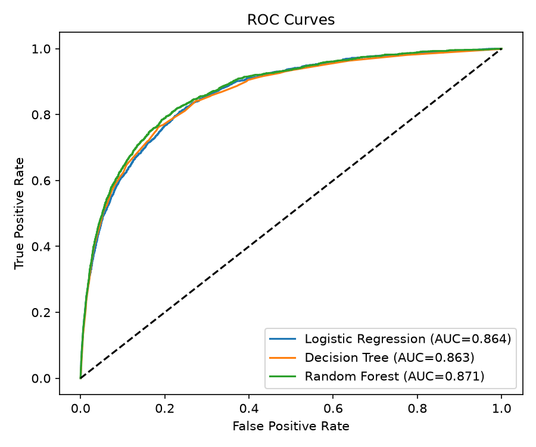
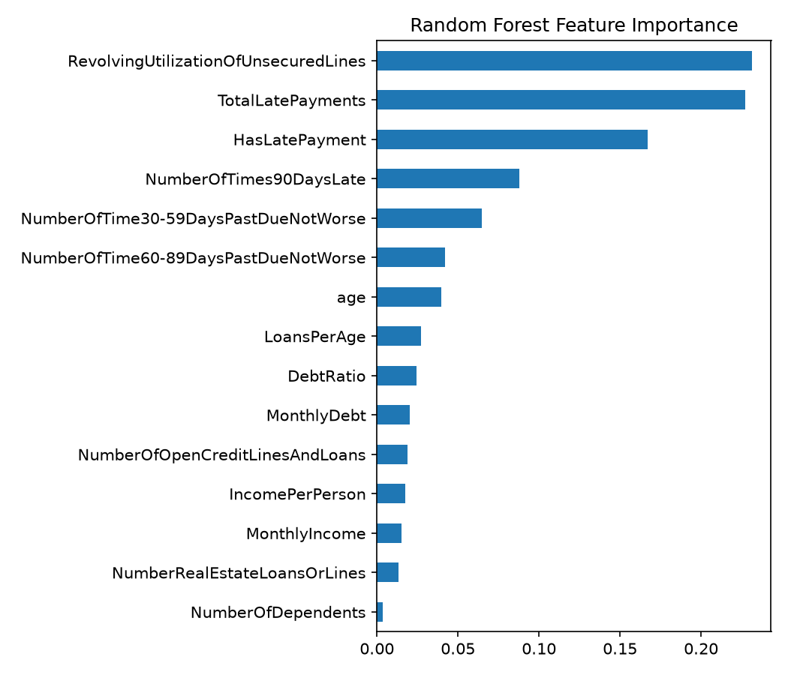

# CodeAlpha Credit Scoring Model

## Objective
Predict whether a person is likely to become seriously delinquent
(90+ days late) on a loan within two years, using past financial data.

## Dataset
"Give Me Some Credit" (Kaggle), 150,000 records, 10 features.
Only about 7% of people are defaulters, so the data is imbalanced.

## Approach
1. **Cleaning:** filled missing income (median) and dependents (0),
   removed invalid ages, capped outliers, fixed 96/98 error codes.
2. **Feature engineering:** TotalLatePayments, HasLatePayment,
   IncomePerPerson, MonthlyDebt, LoansPerAge.
3. **Imbalance handling:** class_weight="balanced".
4. **Models:** Logistic Regression, Decision Tree, Random Forest.
5. **Evaluation:** Precision, Recall, F1-score, ROC-AUC on a stratified
   20% test set.

## Results
| Model | Precision | Recall | F1 | ROC-AUC |
|---|---|---|---|---|
| Logistic Regression | [ ] | [ ] | [ ] | [ ] |
| Decision Tree | [ ] | [ ] | [ ] | [ ] |
| Random Forest | [ ] | [ ] | [ ] | [ ] |

**Best model:** [name] with ROC-AUC [value].

## Key Insights
- [Top 2-3 important features from your plot]
- Precision is low because defaulters are rare. The models flag extra
  people to catch most real defaulters.

## How to Run
pip install pandas numpy scikit-learn matplotlib
python credit_scoring.py

## Author
Muhammad Fahad, CodeAlpha Machine Learning Internship